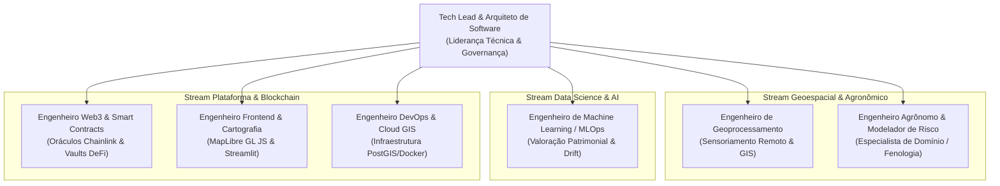
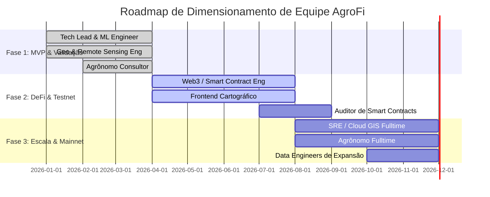

# 👥 Estrutura de Equipe Multidisciplinar - AgroFi

Documentação do dimensionamento, papéis, responsabilidades e governança técnica do time responsável pela expansão, auditoria e operação em produção do **AgroFi (Módulo Agro, Data Science & Visualização)**.

---

## 🎯 1. Visão Geral do Squad
A operação de crédito agrícola colateralizado em blockchain (RWA) exige uma interseção rara entre **Agronomia/Sensoriamento Remoto**, **Engenharia de Machine Learning**, **Sistemas Distribuídos** e **Segurança Web3/DeFi**.

---

## 🧑‍💻 2. Papéis, Atribuições e Perfis Técnicos

### 1. Tech Lead & Arquiteto de Software Sênior
* **Foco:** Arquitetura fim a fim, garantia de SLA, contratos de API e conformidade entre os subsistemas.
* **Hard Skills:** Python, microsserviços de alto desempenho (FastAPI, gRPC), padrões de Clean Architecture, segurança da informação.
* **Entregas Chave:**
  - Manutenção do contrato de payload Web3 (`Web3CollateralPayload`).
  - Governança dos pipelines de dados e latência de oráculos (<200ms).
  - Auditoria de segurança e integridade de dados geoespaciais.

### 2. Engenheiro de Machine Learning & MLOps Sênior
* **Foco:** Manutenção, retreinamento contínuo e monitoramento dos modelos de valoração patrimonial rural.
* **Hard Skills:** LightGBM, XGBoost, Scikit-Learn, MLflow/Weights & Biases, model drift detection, otimização Bayesiana.
* **Entregas Chave:**
  - Pipeline de retreino automático com dados históricos do VTN (Receita Federal) e transações imobiliárias rurais.
  - Mitigação de overfitting territorial (validação cruzada espacial / block cross-validation).
  - Monitoramento de drift de preços de commodities agrícolas e impacto no valor patrimonial da terra.

### 3. Engenheiro de Geoprocessamento & Sensoriamento Remoto Sênior
* **Foco:** Pipeline de dados raster e vetoriais em escala territorial (Brasil).
* **Hard Skills:** GeoPandas, Rasterio, GDAL/OGR, Shapely, PyProj, Sentinel-2/Landsat/Planet APIs, PostGIS.
* **Entregas Chave:**
  - Ingestão massiva e higienização contínua de polígonos do SICAR em âmbito nacional.
  - Processamento quinzenal em lote de séries temporais de NDVI, NDWI e EVI sem contaminação de nuvens.
  - Geração de rasters de declividade, acúmulo de fluxo e microbacias hidrográficas (SRTM / Copernicus DEM).

### 4. Engenheiro Agrônomo & Modelador de Risco Agroclimático
* **Foco:** Inteligência agronômica de safras, janelas críticas de plantio/colheita e parametrização de sinistros.
* **Hard Skills:** Fenologia de grandes culturas (Soja, Milho, Algodão), balanço hídrico do solo (BHS), zoneamento agrícola (ZARC - Embrapa), estatística estocástica.
* **Entregas Chave:**
  - Validação das janelas de risco crítico (floração e enchimento de grãos) para cálculo de anomalia de NDVI.
  - Parametrização agronômica da curva de estresse hídrico e impacto na quebra de produtividade (sacas/ha).
  - Auditoria ambiental de conformidade do CAR com base no Código Florestal (Lei 12.651/2012).

### 5. Engenheiro Web3 & Smart Contracts Sênior
* **Foco:** Desenvolvimento dos protocolos descentralizados de empréstimo (DeFi Lending Vaults) e integração com o Oráculo AgroFi.
* **Hard Skills:** Solidity, Foundry/Hardhat, ERC-721/ERC-3643 (RWA Tokenization), Chainlink Functions / Custom Oracles, Aave/Compound core forks.
* **Entregas Chave:**
  - Smart contracts de depósito de NFT de terra rural como colateral.
  - Implementação on-chain do LTV dinâmico estritamente regulado entre **35% e 65%**.
  - Mecanismo de liquidação paramétrica automatizada em caso de queda do `health_factor < 1.0`.

### 6. Engenheiro Frontend & Cartografia Interativa Pleno/Sênior
* **Foco:** Experiência visual dos analistas de risco, produtores e investidores DeFi.
* **Hard Skills:** MapLibre GL JS, Mapbox GL, Streamlit, React / Next.js, Deck.gl, GeoJSON / Vector Tiles (MVT).
* **Entregas Chave:**
  - Renderização fluida de mapas vetoriais de polígonos agrícolas com milhões de vértices.
  - Painéis de simulação climática em tempo real (sliders paramétricos de estresse hídrico).
  - Interface institucional de solicitação e visualização de crédito colateralizado.

### 7. Engenheiro DevOps & Cloud GIS (SRE)
* **Foco:** Infraestrutura escalável, cache geoespacial e segurança dos endpoints de oráculo.
* **Hard Skills:** Kubernetes, Docker, Terraform, AWS/GCP, PostGIS, Cloudflare, CI/CD (GitHub Actions), Prometheus/Grafana.
* **Entregas Chave:**
  - Provisionamento de nós dedicados para processamento de imagens de satélite.
  - Armazenamento em Cloud Optimized GeoTIFF (COG) e cache de tiles vetoriais.
  - Alta disponibilidade (99.95%) da API REST consumida por nós oráculos.

---

## 📊 3. Matriz de Responsabilidade (RACI)

| Subsistema / Módulo | Tech Lead | ML Eng | Geo Eng | Agrônomo | Web3 Eng | Front Eng | DevOps |
| :--- | :---: | :---: | :---: | :---: | :---: | :---: | :---: |
| **Pipeline SICAR & CAR Geoprocessamento** | A | C | **R** | C | I | I | C |
| **Pipeline SRTM & Declividade Mecânica** | A | C | **R** | C | I | I | C |
| **Sentinel-2 NDVI & Fenologia Temporal** | A | C | **R** | **R** | I | I | C |
| **Modelos de Valoração (LightGBM/XGBoost)** | A | **R** | C | C | I | I | C |
| **Motor de Risco & LTV Dinâmico (35%-65%)** | A | **R** | C | **R** | C | I | I |
| **Smart Contracts & Oráculo Web3** | A | I | I | I | **R** | C | C |
| **Visualização MapLibre & Dashboard** | A | I | C | I | I | **R** | C |
| **Infraestrutura Cloud & Deploy Contínuo** | A | I | I | I | I | I | **R** |

> **Legenda:**
> * **R** (*Responsible*): Quem executa diretamente a tarefa.
> * **A** (*Accountable*): Quem responde pela aprovação e entrega final.
> * **C** (*Consulted*): Especialista consultado para decisões técnicas ou agronômicas.
> * **I** (*Informed*): Mantido informado sobre atualizações e entregas.

---

## 📅 4. Roadmap de Alocação e Escala do Time

