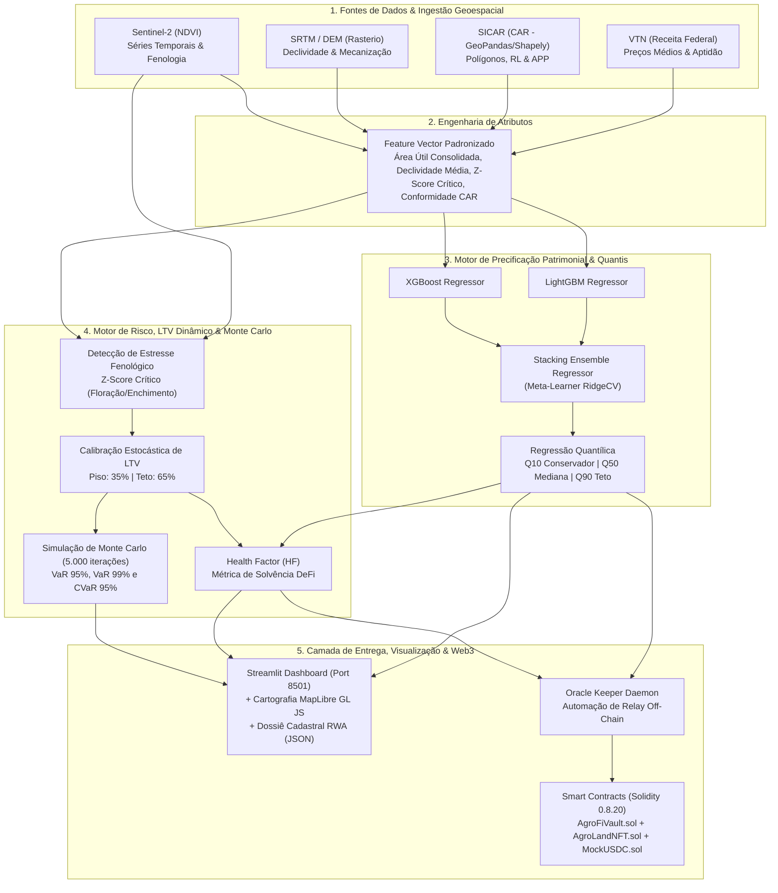

# 🌱 AgroFi - Módulo Agro, Data Science & Visualização

Camada de inteligência geoespacial, precificação patrimonial estocástica de imóveis rurais e motor de **LTV Dinâmico (35% a 65%)** para protocolos DeFi/Web3 (Real World Assets - RWA).

---

## 🏛️ 1. Arquitetura do Sistema



---

## 🚀 2. Stack Tecnológica

| Componente | Ferramentas |
| :--- | :--- |
| **Linguagem** | Python 3.10+ (Executado em Python 3.11) |
| **Ciência de Dados & ML** | Scikit-Learn 1.9.1, LightGBM 4.7.0, XGBoost 3.2.0, Stacking Ensemble |
| **Geoprocessamento & Raster** | GeoPandas 1.2.0, Rasterio 1.4.4, Shapely 2.2.0 |
| **Frontend & Cartografia** | Streamlit 1.67.0, MapLibre GL JS 3.6.2, Tiles Carto/OpenStreetMap |
| **API & Oracle Keeper** | FastAPI 0.162.7, Pydantic 2.14.3, Uvicorn |
| **Smart Contracts (Web3)** | Solidity ^0.8.20, ERC-721 (RWA NFT), ERC-20 (Stablecoin), RBAC, ReentrancyGuard |

---

## 📐 3. Formulação Matemática & Modelagem Estocástica

### 3.1 Precificação Patrimonial e Regressão Quantílica
O pipeline treina LightGBM, XGBoost e Stacking Ensemble ($R^2 \ge 0.989$). Adicionalmente, computa:
* **$Q_{10}$ (Piso Conservador):** Valor de colateral estressado para liquidação rápida.
* **$Q_{50}$ (Mediana):** Valor central de mercado.
* **$Q_{90}$ (Teto Otimista):** Limite superior em safras recordes.

### 3.2 Motor de Risco e LTV Dinâmico (35% a 65%)
$$R_{\text{safra}} = 0.50 \cdot S_{\text{NDVI}} + 0.20 \cdot R_{\text{declividade}} + 0.20 \cdot (1 - C_{\text{CAR}}) + 0.10 \cdot V_{\text{solo}} + \text{ENSO}_{\text{fase}}$$
$$\text{LTV}_{\text{dinâmico}} = \text{clip}\left(0.65 - 0.30 \cdot R_{\text{safra}},\, 0.35,\, 0.65\right)$$

* **Cenário Ótimo:** $R_{\text{safra}} \approx 0 \implies \text{LTV} = 65\%$ (6.500 bps).
* **Cenário Crítico (Seca Severa):** $R_{\text{safra}} \approx 1 \implies \text{LTV} = 35\%$ (3.500 bps).

### 3.3 Simulação de Monte Carlo & Value at Risk (VaR)
Com 5.000 iterações de choques assimétricos de clima:
* $\text{VaR}_{95\%}$: Perda máxima esperada com 95% de confiança em 1 safra.
* $\text{CVaR}_{95\%}$ (Expected Shortfall): Perda média nas piores 5% caudas de estresse hídrico.

### 3.4 Health Factor (HF)
$$\text{Health Factor} = \frac{\text{LTV}_{\text{dinâmico}}}{\text{LTV}_{\text{alavancagem}}}$$
* $\text{HF} \ge 1.20$: **Seguro (Verde)**
* $1.00 \le \text{HF} < 1.20$: **Atenção (Amarelo)**
* $\text{HF} < 1.00$: **Liquidação Paramétrica Desencadeada On-Chain (Vermelho)**

---

## 📦 4. Contratos Inteligentes Web3 (`contracts/` & `out/`)

O projeto suporta tanto o protocolo de valoração direta quanto a suíte descentralizada de empréstimos com liquidação paramétrica:

1. **[AgroFiVault.sol](contracts/AgroFiVault.sol):** Protocolo central de colateralização, custódia de NFT, empréstimo de stablecoin, travas paramétricas [3500, 6500 bps] e liquidação paramétrica (escala 18 decimais / WAD).
2. **[AgroLandNFT.sol](contracts/AgroLandNFT.sol):** Título de propriedade rural tokenizado (ERC-721) com metadados CAR e georreferenciamento.
3. **[LendingPool.sol](contracts/LendingPool.sol):** Pool de liquidez e empréstimos DeFi com liquidação paramétrica imediata (implantado na Sepolia e compatível com Anvil local).
4. **[AgroNFT.sol](contracts/AgroNFT.sol):** Tokenização de safras e colateral agrícola dinâmico com LTV e Health Factor ajustáveis por nós oráculos autorizados.
5. **[MockUSDC.sol](contracts/MockUSDC.sol):** Stablecoin ERC-20 simuladora de liquidez.

### 📍 Endereços dos Contratos

* **Ethereum Sepolia Testnet:**
  * `MockUSDC`: [`0x178B9bFA3E86a9Ed3F67963e28afBe49BCf45ED2`](https://sepolia.etherscan.io/address/0x178B9bFA3E86a9Ed3F67963e28afBe49BCf45ED2)
  * `AgroNFT`: [`0xb89Cd470755AD1E25052b57D97af6Fc98b00Dfb2`](https://sepolia.etherscan.io/address/0xb89Cd470755AD1E25052b57D97af6Fc98b00Dfb2)
  * `LendingPool`: [`0x020c06c4d1410B2131e9815c5D25F7Ee90D37a26`](https://sepolia.etherscan.io/address/0x020c06c4d1410B2131e9815c5D25F7Ee90D37a26)
* **Ambiente Local (Anvil / 31337):** Registrado automaticamente em `deployed_addresses.json`.

---

---

## 🖥️ 5. Como Executar

### 5.1 Configuração do Ambiente Virtual & Variáveis
```powershell
# 1. Criação e ativação do ambiente virtual
python -m venv .venv
.\.venv\Scripts\Activate.ps1

# 2. Instalação das dependências
pip install -r requirements.txt

# 3. Configuração do Cofre de Chaves (.env)
Copy-Item .env.example .env
# Edite o .env se desejar customizar as chaves privadas de teste
```

### 5.2 Iniciar o Portal Web3 Principal (Página Inicial - Porta 8080)
O portal web principal serve como ponto de entrada com autenticação criptográfica via carteiras Web3 (**Rabby Wallet** ou **MetaMask**):
```powershell
.\.venv\Scripts\python.exe -m http.server 8080
```
👉 Acesse: `http://localhost:8080`
* Suporta conexão via Rabby Wallet (padrão) e MetaMask.
* Solicita assinatura criptográfica EIP-191 (`personal_sign`) sem custo de gas.
* Valida a Whitelist:
  * **Admin Master (`0xa449e7838fF89EE956174B682449870597e93C71`)**: Acesso irrestrito a todas as propriedades rurais.
  * **Fazendas Cadastradas**: Acesso isolado e restrito aos dados do seu próprio talhão.
  * **Carteiras Não Cadastradas**: Acesso recusado com bloqueio imediato.

### 5.3 Iniciar o Dashboard Streamlit (Porta 8501)
Painel interativo de inteligência patrimonial, simulações de Monte Carlo e cartografia geoespacial:
```powershell
$env:PYTHONPATH="."
.\.venv\Scripts\streamlit.exe run app.py --server.port 8501
```
👉 Acesse: `http://localhost:8501` (redirecionado automaticamente com a sessão autenticada do portal 8080).

### 5.4 Iniciar a API do Orquestrador AgroFi (FastAPI - Porta 8000)
```powershell
$env:PYTHONPATH="."
.\.venv\Scripts\uvicorn.exe src.api.service:app --host 127.0.0.1 --port 8000 --reload
```
👉 Acesse a documentação Swagger interativa: `http://127.0.0.1:8000/docs`.

### 5.5 Executar o Oráculo & Integração Web3

O módulo Web3 detecta automaticamente a rede disponível:

* **Opção A - Modo Local Anvil:**
  1. Em um terminal, inicie o nó local Anvil:
     ```powershell
     anvil
     ```
  2. Em outro terminal, execute o teste de estresse ponta a ponta:
     ```powershell
     $env:PYTHONPATH="."
     .\.venv\Scripts\python.exe -m middleware.stress_test
     ```
  3. Ou execute a sincronização do oráculo:
     ```powershell
     $env:PYTHONPATH="."
     .\.venv\Scripts\python.exe integrar_oraculo.py
     ```

* **Opção B - Modo Ethereum Sepolia Testnet:**
  Se o nó Anvil não estiver rodando, o oráculo conecta automaticamente aos contratos na Sepolia:
  ```powershell
  $env:PYTHONPATH="."
  .\.venv\Scripts\python.exe integrar_oraculo.py
  ```

### 5.6 Executar a Bateria Completa de Testes
```powershell
$env:PYTHONPATH="."
.\.venv\Scripts\pytest.exe
```
Resultado esperado: **11 de 11 testes aprovados (100% de sucesso).**

